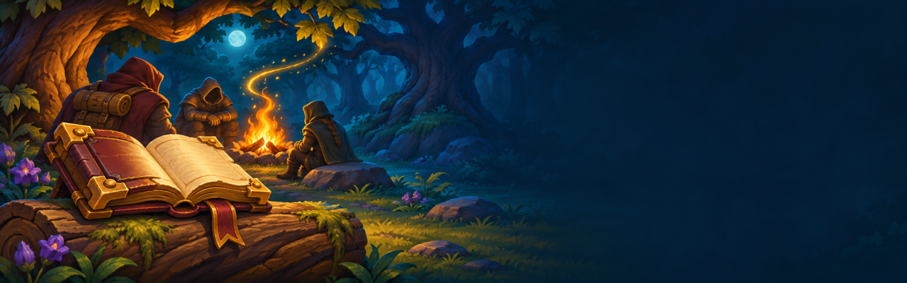

# CurseForge listing

Everything the project form asks for. Paste the description in Markdown mode.

| Field | Value |
| --- | --- |
| Game | World of Warcraft |
| Class | Addons |
| Name | Fireside Tales |
| Summary | Tell stories at the campfire, one line at a time. 600+ tales, read aloud in each teller's voice, plus new player stories every week. |
| Main category | Roleplay |
| Additional categories | Chat & Communication, if it's offered |
| Allow comments | On |
| Experimental | Off |
| Game version | 1.60.1 (WoW Forever) |
| License | MIT |

## Description

**Stay awhile and listen.**

Stop sitting at campfires in silence. Tell any of 600+ tales line by line in `/say` and `/e`, and hear the stories around you read aloud in the teller's own voice.

## Storytelling made easy

Click the minimap book or type `/tales`, pick a story, and press **Speak** for each line. Stuck? **Tell a Tale** picks one for you. There are stories for your race, class and zone, legends told across several nights, rumors, riddles and festival tales, all a minute or less.

## Fully voiced

Every story told near you is read aloud in a voice that fits the teller's race, man or woman. Grab the races you play with, or all of them. The Narrator covers any race you don't have.

### Available Voice Packs

| Alliance | Horde | Everyone |
| --- | --- | --- |
| [Human](https://www.curseforge.com/wow/addons/fireside-tales-voices-human) | [Orc](https://www.curseforge.com/wow/addons/fireside-tales-voices-orc) | [Narrator](https://www.curseforge.com/wow/addons/fireside-tales-voices-narrator): reads for missing races |
| [Dwarf](https://www.curseforge.com/wow/addons/fireside-tales-voices-dwarf) | [Undead](https://www.curseforge.com/wow/addons/fireside-tales-voices-undead) | [Community](https://www.curseforge.com/wow/addons/fireside-tales-voices-community): this week's player stories |
| [Night Elf](https://www.curseforge.com/wow/addons/fireside-tales-voices-night-elf) | [Tauren](https://www.curseforge.com/wow/addons/fireside-tales-voices-tauren) | [Skyborne](https://www.curseforge.com/wow/addons/fireside-tales-voices-skyborne): either faction |
| [Gnome](https://www.curseforge.com/wow/addons/fireside-tales-voices-gnome) | [Troll](https://www.curseforge.com/wow/addons/fireside-tales-voices-troll) | |

Free, about 250 MB per race. See what you have in the **Voices** tab (`/tales voices`).

## Share your story

Write your own at **[firesidetales.dev](https://firesidetales.dev/submit)**, the way you'd type it in game. Picked stories go into the addon's **Community** tab and the Community voice pack, so every player can tell them at their own fire. **Community stories rotate every week:** a fresh batch arrives each Tuesday, credited to your character and fully voiced.

## Tales about your character

**Write Your Tales** helps any AI chat write stories about your character. They stay on your computer and aren't voiced. To share one with everyone, send it in on the site.

## Good to know

Some stories are made with the help of AI, and the voices are AI-generated. Fireside Tales is free and isn't affiliated with Blizzard. Bugs or ideas: [firesidetales.dev/feedback](https://firesidetales.dev/feedback).

## Commands

| Command | What it does |
| --- | --- |
| `/tales` | Open the story menu |
| `/tales add` | Open Write Your Tales |
| `/tales voices` | Open the Voices tab |
| `/tales fire` | Turn the campfire prompt off or on |
| `/tales minimap` | Show or hide the minimap icon |
| `/tales status` | Show your story counts |
