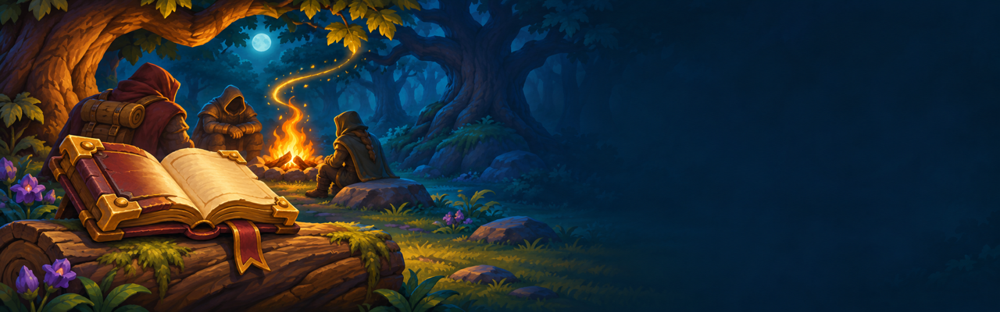

# CurseForge listing

Everything the project form asks for. Paste the description in Markdown mode.

| Field | Value |
| --- | --- |
| Game | World of Warcraft |
| Class | Addons |
| Name | Fireside Tales |
| Summary | Tell stories at the campfire, one line at a time: 500+ tales for every race, class, and zone, plus your own character's. |
| Main category | Roleplay |
| Additional categories | Chat & Communication, if it's offered |
| Allow comments | On |
| Experimental | Off |
| Game version | 1.60.1 (WoW Forever) |
| License | MIT |

## Description

**You light a fire, someone sits down beside you, and nobody says a word.** Fireside Tales gives you something to say. Press a button and tell one of more than 500 short tales, one line at a time, in `/say` and `/e`. Everyone around the fire just sees you telling a story, and they don't need the addon to enjoy it.

### What it looks like at the fire

This is "The Last Honest Merchant," one of the built-in stories, as everyone nearby sees it:

> **Brenna says:** Ever met an honest merchant? I did, once. He sold me a mule and told me it was a terrible mule.
>
> **Brenna says:** Bites, he said. Kicks. Lies down in rivers. Will outlive you purely out of spite.
>
> **Brenna says:** I bought it anyway, because a man that truthful surely had to be joking.
>
> *Brenna rolls up one sleeve to show an old, crescent-shaped scar.*
>
> **Brenna says:** He was not joking.
>
> **Brenna says:** Best mule I ever owned. Carried me through two winters and bit everyone who tried to rob me.

### Stories for everyone

- **For your character:** tales for every race and class, chosen automatically.
- **For where you are:** stories of all 45 zones. The ones about your current zone rise to the top.
- **For someone nearby:** target a listener, and the story uses their name.
- **Legends:** Warcraft's own stories, told in parts, from the Legend of Stalvan to Onyxia's masquerade in Stormwind. Stop after any part and pick it up another night.
- **Rumors and Whispers:** short things people swear they heard, from a vault combination that ends in a sneeze to cold roses in Darkshire.
- **Quick to tell:** every story takes about a minute or less, so nobody's stuck waiting.

### Tell your own

**Write My Story** turns any AI into your character's storyteller. Write a sentence or two about who they are, copy the ready-made prompt, and paste the answer back in the game. Your tales appear under your character's name, ready to tell. Your name, race, class, and zone are already filled in, and you can read every story before you tell it.

### Easy at the fire

1. Click the book on the minimap, or type `/tales`.
2. Pick a story, or press **Tell a Tale** and let the fire choose.
3. Press **Tell**, then **Speak** for each line. Start with an **Opener** to gather people, and end with a **Closer** if you like.

**Tell a Tale** picks a story you haven't told yet, about the zone you're in if it can. Press it again for another.

Sit down at a campfire and a small prompt asks if you'd like to tell a story, once per fire. It's easy to take, easy to ignore, and `/tales fire` turns it off.

A small bar shows the next line and a cue for when people have had time to read, along with what's being said nearby. You can search, filter by mood, star your favorites, and line up stories for tonight.

Fireside Tales never sends chat by itself. Every line waits for you to press **Speak**.

### Commands

| Command | What it does |
| --- | --- |
| `/tales stories` | Open or close the story menu |
| `/tales add` | Open or close Write My Story |
| `/tales fire` | Turn the campfire prompt off or on |
| `/tales minimap` | Show or hide the minimap icon |
| `/tales status` | Show your story counts |

### Good to know

The built-in stories are original tales written with AI help and chosen by hand, and the logo and banner are AI-assisted art. Screenshots are from the real game. The stories are fan fiction set in Azeroth, not official lore. This addon is free, and it isn't affiliated with or endorsed by Blizzard Entertainment.

Found a bug, or a story that doesn't sit right? Leave a comment, or open an issue on [GitHub](https://github.com/alexinslc/fireside-tales).
